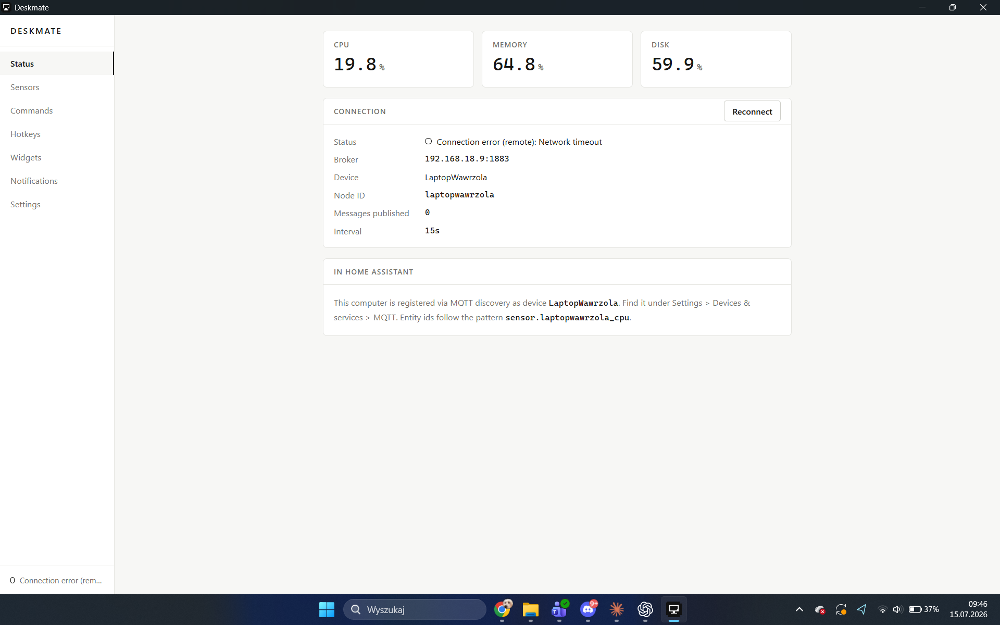
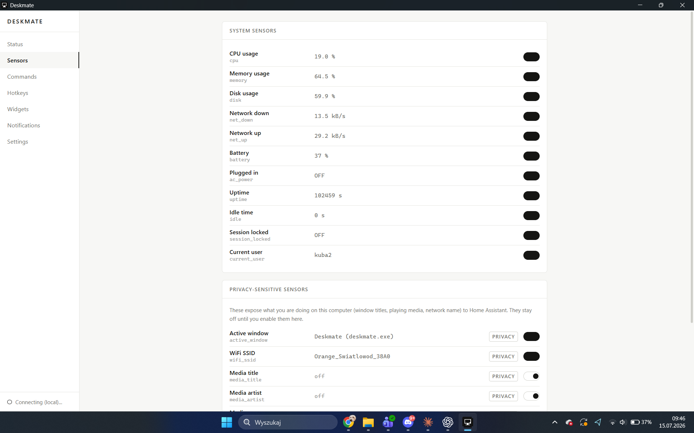
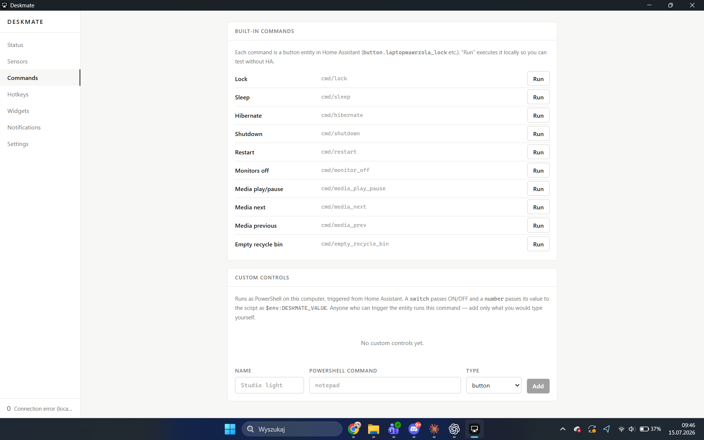
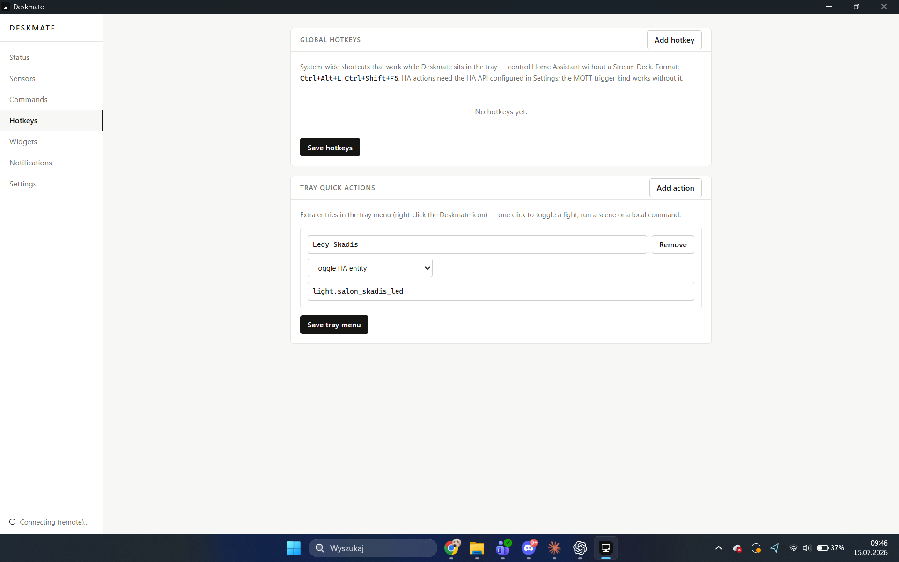

# Deskmate

Deskmate puts your computer into Home Assistant as a device, with sensors,
power and media buttons, notifications with buttons, files from your phone
and screen time rules for the kids. It brings its own integration and talks
to it over one encrypted connection that the PC opens, so there is no MQTT
broker to set up (MQTT still works if you already run one). Open source, for
Windows 10 and 11 on **x64 and ARM64** (Snapdragon laptops included). An
optional Windows service keeps the PC in Home Assistant while nobody is
signed in, and Linux is available as a preview.

**Start with the [guide](docs/GUIDE.md).** It goes from installing to
automations in one place.

[](https://my.home-assistant.io/redirect/hacs_repository/?owner=JakubWawrzola&repository=deskmate&category=integration)

Deskmate is in the default HACS catalog, so no custom repository is needed.

## Quick start (about 5 minutes)

1. **Home Assistant:** in HACS search for **Deskmate** (or press the button
   above), download it and restart Home Assistant.
2. **Home Assistant:** *Settings → Devices & services → Add integration →
   Deskmate*. Copy the pairing code it shows (`DMP1.…`).
3. **PC:** install `Deskmate_<version>_x64-setup.exe` or `_arm64-setup.exe`
   from [Releases](https://github.com/JakubWawrzola/deskmate/releases), paste
   the code, *Connect*. The PC appears as a device in Home Assistant.

On Linux, step 3 is a package and one command: see
[docs/LINUX.md](docs/LINUX.md). To set Deskmate up with an AI assistant, point
it at [docs/AI-DEPLOY.md](docs/AI-DEPLOY.md).

## Screenshots

| Status | Sensors | Commands |
|---|---|---|
|  |  |  |

| Hotkeys | Widgets | Notifications |
|---|---|---|
|  |  |  |

## What it does

**Your PC in Home Assistant**

- CPU, memory, disks, network, battery, uptime, and GPU and temperatures where
  the hardware allows (CPU temperature too, with a small optional helper).
- Whether someone is at the PC: idle time (game controllers count too), last
  activity, locked or not, who is signed in, whether the screen is on.
- If you want them: the window you are in, the Wi-Fi name, what is playing
  (with a media player entity for any media card), camera and microphone in
  use, gaming or presenting. Off until you turn them on.
- Your own sensors: is a program running, is a window open, is a Windows
  service up, or anything a script can tell.
- With the optional Deskmate service, the sensors and power buttons stay
  while nobody is signed in, at the sign-in screen and after a restart.

**Control the PC from Home Assistant**

- Lock, sleep, hibernate, shut down, restart, sign out, screens off, screen
  brightness, volume, mute, media keys, keep awake.
- Mute the microphone and choose the speakers, headset or microphone Windows
  uses.
- Start or close programs, press key combinations (Ctrl+F5 to reload a page),
  or run your own scripts as buttons, switches and sliders.
- Type text, move through a presentation, open a web page, wake the screen,
  read text out loud. Off until you turn them on.

**Notifications**

- Windows notifications from Home Assistant, with a picture and buttons that
  start automations. The doorbell on your screen, with *Open gate* on it. A
  tag replaces the earlier one, and an automation can clear it once the door
  is open.

**Screen time and family rules**

- Screen time for each Windows account, a daily limit, allowed hours, a block
  list for games and apps, and an *Ask for more time* button that reaches
  your phone.
- Counted and enforced on the PC, without internet and without a Microsoft
  account. With one administrator password a child cannot just close it.

**Files and clipboard**

- Send files from your phone or laptop to the PC, download from folders you
  share, through the Deskmate page in the Home Assistant sidebar.
- Copy on the PC, paste on your phone, and the other way round.

**Control your home from the PC**

- Hotkeys, a small always-on-top panel with the entities you pick, Home
  Assistant dashboards in their own window, your own shortcuts in the tray.
- A [Stream Deck plugin](docs/STREAMDECK.md) that Deskmate installs. Its keys
  work through Deskmate without a token of their own.

**Linux**

- A daemon with the sensors and power buttons, and the desktop app with
  notifications, media controls and files. See [docs/LINUX.md](docs/LINUX.md).

**Everyday**

- Light and dark theme, starts with Windows, installs its own updates and
  asks first unless you choose otherwise.
- Several computers, and several Windows users on one computer; see the
  [guide](docs/GUIDE.md#10-several-computers-several-windows-users).

## Security in short

- One encrypted connection from the PC to Home Assistant: an X25519 exchange
  with fresh keys every session, AES-256-GCM frames, replay protection, optional
  second cipher layer. Keys live in Windows Credential Manager.
- Anything that reveals what you do or lets Home Assistant act beyond the
  built-in buttons is off until you turn it on, and much of it can ask on the PC
  first.
- No telemetry. The only call home is the daily update check on GitHub,
  which you can switch off, and Deskmate runs only an installer signed with
  the project's release key. Home Assistant cannot start an update.

The threat model, including what it does not protect against:
[docs/SECURITY.md](docs/SECURITY.md).

## Why not HASS.Agent?

If HASS.Agent or its [active fork](https://github.com/hass-agent/HASS.Agent)
already does what you need, use it. Deskmate exists because of two gaps I kept
hitting: no native ARM64 build, and a handful of entities I wanted
(camera and mic in use, keep awake as a switch, hotkeys as Home Assistant
events, a widget panel, files from the phone).

## Documentation

- [docs/GUIDE.md](docs/GUIDE.md): the guide, start here
- [docs/LINUX.md](docs/LINUX.md): the Linux daemon and desktop app
- [docs/STREAMDECK.md](docs/STREAMDECK.md): the Stream Deck plugin
- [docs/SECURITY.md](docs/SECURITY.md): threat model and defaults
- [docs/LINK.md](docs/LINK.md): the connection, pairing, remote access, protocol
- [docs/HA-SETUP.md](docs/HA-SETUP.md) and [docs/MIGRATION.md](docs/MIGRATION.md):
  the MQTT route, and moving from it
- [CHANGELOG.md](CHANGELOG.md) and [docs/releases/](docs/releases/): release history
- [docs/dev/](docs/dev/): architecture and notes for contributors
- [CONTRIBUTING.md](CONTRIBUTING.md): reporting bugs, asking for features,
  sending changes

## Building from source

```
npm install
npm run tauri dev            # development
npm run tauri build          # release for the current architecture
npm run tauri build -- --target x86_64-pc-windows-msvc   # cross to x64
```

Toolchain: Node 24, Rust stable (`aarch64-pc-windows-msvc` and/or
`x86_64-pc-windows-msvc`). No C compiler needed on either architecture. A
release build also packs the Stream Deck plugin and the Deskmate service, and
stops after writing the installer when no update signing key is set.

## License

MIT
