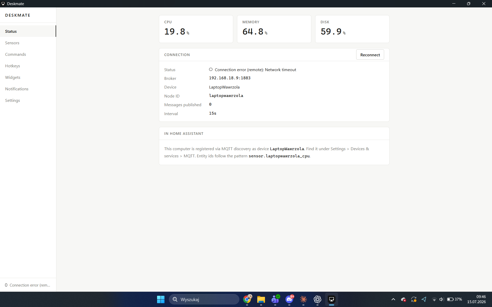
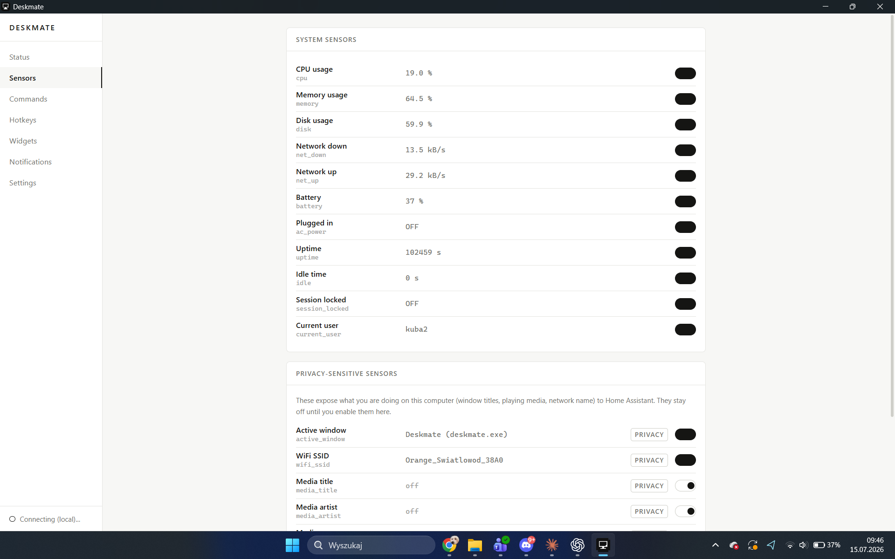
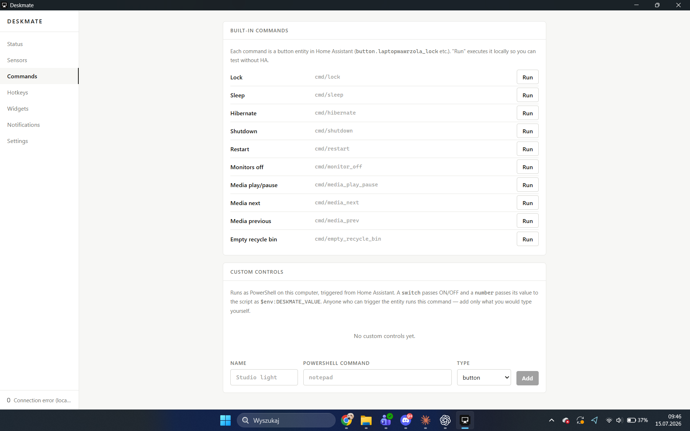
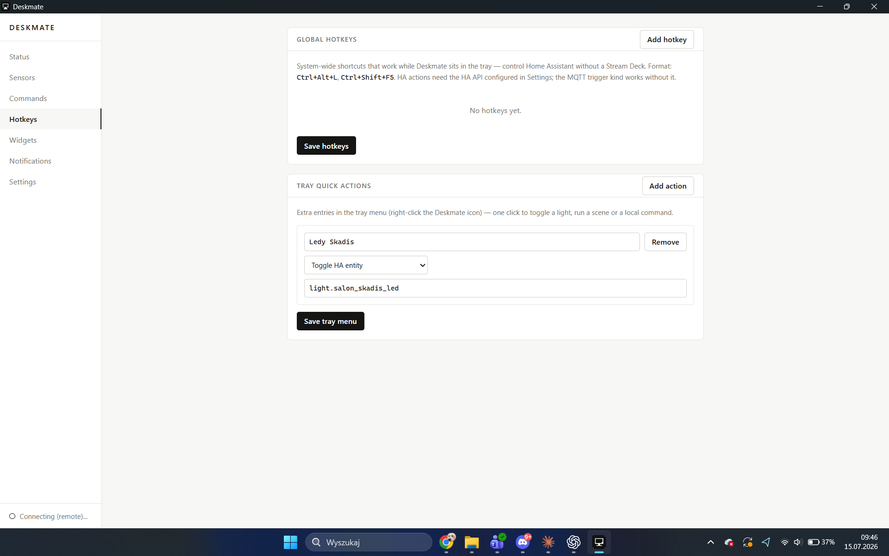
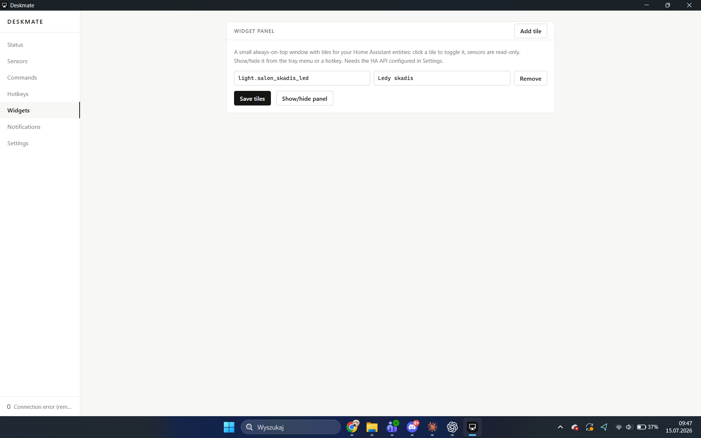
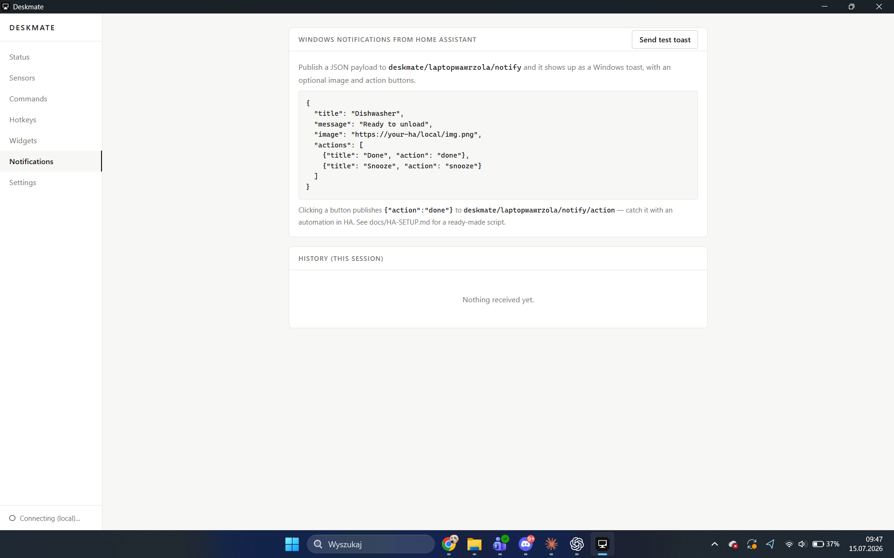

# Deskmate

A modern, open-source Windows companion for Home Assistant, in the spirit of
HASS.Agent. Your PC shows up in Home Assistant as a device with sensors,
buttons, switches and notifications, your keyboard becomes a remote for your
home, your phone can drop files straight onto the PC, and the kids' screen time
rules run on the PC itself, without a Microsoft account.

It talks to its own Home Assistant integration over one encrypted connection,
so there is no MQTT broker to set up (MQTT still works if you already run one).
Native on Windows 10 and 11, **x64 and ARM64** (Snapdragon laptops included),
with a ~3 MB installer.

**New here? Read the [guide](docs/GUIDE.md).** It goes from installing to
automations in one place.

[](https://my.home-assistant.io/redirect/hacs_repository/?owner=JakubWawrzola&repository=deskmate&category=integration)

The button works once the repository has been added to HACS as a custom
repository (step 1 below); HACS does not add an unknown repository from a link.

## Quick start (about 5 minutes)

1. **Home Assistant:** HACS → three dots → *Custom repositories* → add
   `https://github.com/JakubWawrzola/deskmate` as *Integration*. Download
   **Deskmate**, restart Home Assistant.
2. **Home Assistant:** *Settings → Devices & services → Add integration →
   Deskmate*. Copy the pairing code it shows (`DMP1.…`).
3. **PC:** install `Deskmate_<version>_x64-setup.exe` or `_arm64-setup.exe`
   from [Releases](https://github.com/JakubWawrzola/deskmate/releases), paste
   the code, *Connect*. The PC appears as a device in Home Assistant.

Setting this up with an AI assistant? Point it at
[docs/AI-DEPLOY.md](docs/AI-DEPLOY.md).

## Screenshots

| Status | Sensors | Commands |
|---|---|---|
|  |  |  |

| Hotkeys | Widgets | Notifications |
|---|---|---|
|  |  |  |

## What it does

**Your PC in Home Assistant**

- CPU, memory, disks, network, battery, uptime, and GPU and temperatures where
  the hardware allows (CPU temperature too, with a small optional helper).
- Whether someone is at the PC: idle time, last activity, locked or not, who is
  signed in, a presentation or full-screen video running.
- If you want them: the window you are in, the Wi-Fi name, what is playing,
  whether the camera or the microphone is in use. Off until you turn them on.
- Your own sensors: is a program running, is a window open, is a Windows
  service up, or anything a script can tell.

**Control the PC from Home Assistant**

- Lock, sleep, hibernate, shut down, restart, sign out, turn the screens off.
- Volume, mute, play/pause, next track, keep the PC awake.
- Mute the microphone and set its level, for example as soon as the radio
  starts.
- Choose the speakers, headset or microphone Windows uses.
- Start or close programs, press key combinations (Ctrl+F5 to reload a page),
  or run your own scripts as buttons, switches and sliders.
- Type text, move through a presentation, open a web page, read text out loud.
  Off until you turn them on.

**Notifications**

- Windows notifications from Home Assistant, with a picture and buttons that
  start automations. The doorbell on your screen, with *Open gate* on it.

**Screen time and family rules**

- Screen time for each Windows account, a daily limit, extra time for today,
  allowed hours (bedtime).
- Warnings before the time runs out, then the PC locks or signs out.
- An *Ask for more time* button that reaches your phone through Home Assistant.
- Block games and apps.
- Works without internet and without a Microsoft account. With one
  administrator password a child cannot just close it.

**Files and clipboard**

- Send files from your phone or laptop to the PC, download from folders you
  share. All through the Deskmate page in the Home Assistant sidebar.
- Copy on the PC, paste on your phone, and the other way round.

**Control your home from the PC**

- Hotkeys that switch lights or start scenes from any app.
- A small always-on-top panel with the entities you pick.
- Home Assistant dashboards in their own window, and your own shortcuts in the
  tray menu.
- A [Stream Deck plugin](streamdeck-plugin/README.md).

**Everyday**

- Light and dark theme, starts with Windows, tells you when an update is out.
- Several computers, and several Windows users on one computer; see the
  [guide](docs/GUIDE.md#10-several-computers-several-windows-users).
- Windows 10 and 11, x64 and ARM64 (Snapdragon laptops too), a 3 MB installer.

## Security in short

- One encrypted connection from the PC to Home Assistant: an X25519 exchange
  with fresh keys every session, AES-256-GCM frames, replay protection, optional
  second cipher layer. Keys live in Windows Credential Manager.
- Anything that reveals what you do or lets Home Assistant act beyond the
  built-in buttons is off until you turn it on, and much of it can ask on the PC
  first.
- No PowerShell for notifications, no telemetry. The only call home is an
  optional daily look at GitHub for a newer release.

The threat model, including what it does not protect against:
[docs/SECURITY.md](docs/SECURITY.md).

## Why not HASS.Agent?

If HASS.Agent or its [active fork](https://github.com/hass-agent/HASS.Agent)
already does what you need, use it. Deskmate exists because of two gaps I kept
hitting: no native ARM64 build, and a handful of entities I wanted
(camera and mic in use, keep awake as a switch, hotkeys as Home Assistant
events, a widget panel, files from the phone).

## Documentation

- [docs/GUIDE.md](docs/GUIDE.md): the guide, start here
- [docs/LINK.md](docs/LINK.md): the connection, pairing, remote access, protocol
- [docs/SECURITY.md](docs/SECURITY.md): threat model and defaults
- [docs/HA-SETUP.md](docs/HA-SETUP.md) and [docs/MIGRATION.md](docs/MIGRATION.md):
  the MQTT route, and moving from it
- [CHANGELOG.md](CHANGELOG.md) and [docs/releases/](docs/releases/): release history
- [docs/dev/](docs/dev/) and [HANDOFF.md](HANDOFF.md): architecture and notes
  for contributors
- [CONTRIBUTING.md](CONTRIBUTING.md): reporting bugs, asking for features,
  sending changes

## Building from source

```
npm install
npm run tauri dev            # development
npm run tauri build          # release for the current architecture
npm run tauri build -- --target x86_64-pc-windows-msvc   # cross to x64
```

Toolchain: Node 20+, Rust stable (`aarch64-pc-windows-msvc` and/or
`x86_64-pc-windows-msvc`). No C compiler needed on either architecture.

## License

MIT
