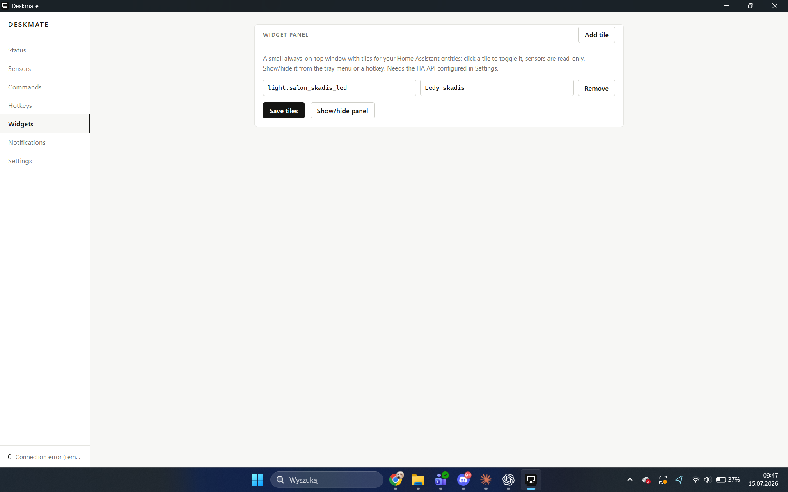
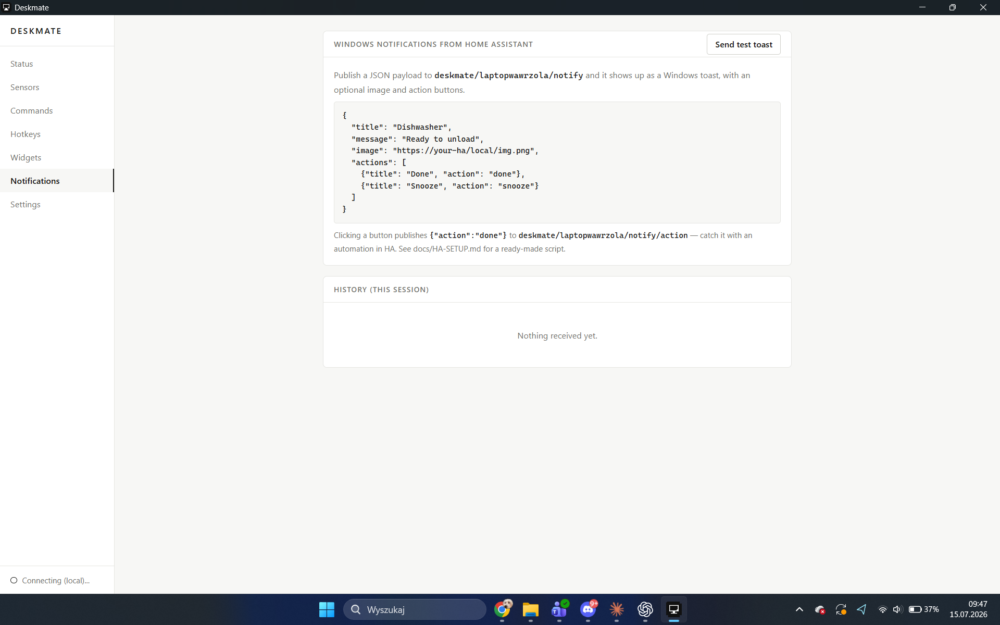

# Deskmate

Deskmate adds your computers to Home Assistant as devices. It has its own
Home Assistant integration and runs on the computer as a desktop app, as a
background service while nobody is signed in, and on Linux as a daemon. You
get sensors, power and media buttons, a media player, notifications with
action buttons, files sent from your phone, screen time rules for children
and a Stream Deck plugin. The integration replaces MQTT, so you do not need a
broker. MQTT still works if you already run one.

Deskmate is open source. It runs on:

| Platform | What you install |
|---|---|
| Windows 10 and 11, x64 and ARM64 (Snapdragon laptops included) | The desktop app, and if you want the optional Deskmate service |
| Linux, x86_64 and ARM64 (preview) | The daemon without a window, the desktop app, or both |
| Stream Deck | The plugin, from the app's Settings |

To try it, follow the three steps below. The [guide](docs/GUIDE.md) covers
everything from installing to automations.

[](https://my.home-assistant.io/redirect/hacs_repository/?owner=JakubWawrzola&repository=deskmate&category=integration)

Deskmate is in the default HACS catalog, so no custom repository is needed.

## Quick start (about 5 minutes)

1. In HACS, search for **Deskmate** (or press the button above), download it
   and restart Home Assistant.
2. In Home Assistant, go to *Settings → Devices & services → Add integration
   → Deskmate*. Copy the pairing code it shows (`DMP1.…`).
3. On a Windows PC, download the installer from
   [Releases](https://github.com/JakubWawrzola/deskmate/releases):
   `Deskmate_<version>_x64-setup.exe` for most PCs,
   `Deskmate_<version>_arm64-setup.exe` for ARM64 PCs such as Snapdragon
   laptops. The installer is not code-signed, so SmartScreen warns about an
   unknown publisher. Choose *More info*, then *Run anyway*. Paste the code
   and click *Connect*. The PC appears as a device in Home Assistant.

On Linux, install the daemon and run `sudo deskmate-service pair` with the
code from step 2, or install the desktop app and paste the code into its
window. [docs/LINUX.md](docs/LINUX.md) has the packages and the steps. To set
Deskmate up with an AI assistant, point it at
[docs/AI-DEPLOY.md](docs/AI-DEPLOY.md).

## Screenshots

| Status | Sensors | Commands |
|---|---|---|
|  |  |  |

| Hotkeys | Widgets | Notifications |
|---|---|---|
|  |  |  |

## What it does

The list describes the Windows app. On Linux the preview covers part of it;
[docs/LINUX.md](docs/LINUX.md) has the table.

**Your computer in Home Assistant**

- CPU, memory, disks, network, battery, uptime, and GPU and temperatures where
  the hardware allows (CPU temperature too, with a small optional helper).
- Whether someone is at the PC: idle time (game controllers count too),
  locked or not, who is signed in, whether the screen is on, presenting or
  full screen, and, once you turn it on, the time of the last activity.
- If you want them: the window you are in, the Wi-Fi name, what is playing
  (with a media player entity for any media card), camera and microphone in
  use, and *User state* (gaming, presenting, busy). Off until you turn them
  on.
- Your own sensors: is a program running, is a window open, is a Windows
  service up, or anything a script can tell.
- Install the optional Deskmate service from Settings and the PC stays in
  Home Assistant at the sign-in screen and after a restart, with processor,
  memory, system drive, network, uptime and battery sensors and the power
  buttons. A *Connection* sensor shows whether the app, the service or nobody
  is connected, and whether the PC is asleep or off.

**Control the PC from Home Assistant**

- Lock, sleep, hibernate, shut down, restart, sign out, screens off, screen
  brightness, volume, mute, media keys, keep awake.
- Mute the microphone and choose the speakers, headset or microphone Windows
  uses.
- Start or close programs, press key combinations (Ctrl+F5 to reload a page),
  or run your own scripts as buttons, switches and sliders.
- Type text, move through a presentation, open a web page, wake the screen,
  read text out loud. Off until you turn them on.

**Notifications**

- Windows notifications from Home Assistant, with a picture and buttons that
  start automations. The doorbell on your screen, with *Open gate* on it. A
  tag replaces the earlier one, and an automation can clear it once the door
  is open.

**Screen time and family rules**

- Screen time for each Windows account, a daily limit, allowed hours, a block
  list for games and apps, and an *Ask for more time* button that reaches
  your phone.
- Counted and enforced on the PC, without internet and without a Microsoft
  account. With one administrator password a child cannot just close it.

**Files and clipboard**

- Send files from your phone or laptop to the PC, download from folders you
  share, through the Deskmate page in the Home Assistant sidebar.
- Copy on the PC, paste on your phone, and the other way round.

**Control your home from the PC**

- Hotkeys, a small always-on-top panel with the entities you pick, Home
  Assistant dashboards in their own window, your own shortcuts in the tray.
- A [Stream Deck plugin](docs/STREAMDECK.md) that comes with Deskmate.
  Install it from Settings → *Stream Deck* and turn on *Let Stream Deck use
  Deskmate* (off by default). Its keys then use the Home Assistant address
  and token set in Deskmate, so Stream Deck needs no token of its own.

**Linux (preview)**

- A daemon with the sensors and power buttons that runs without anyone signed
  in, packaged as `.deb` and a tarball, under a locked-down systemd unit.
- The desktop app as `.deb` and AppImage: pairing, sensors, power buttons,
  lock, notifications, media player and media controls, volume and files.
  See [docs/LINUX.md](docs/LINUX.md).

**Everyday**

- Light and dark theme, and it starts when you sign in.
- On Windows, Deskmate installs updates after you say yes. Settings →
  *Updates* can make it install them on its own, or only tell you.
- Several computers, and several Windows users on one computer; see the
  [guide](docs/GUIDE.md#10-several-computers-several-windows-users).

## Security in short

- One encrypted connection from the PC to Home Assistant: an X25519 exchange
  with fresh keys every session, AES-256-GCM frames, replay protection, optional
  second cipher layer. Keys live in Windows Credential Manager; on Linux in
  the desktop keyring, or in a key file only root and the daemon can read.
- Anything that reveals what you do or lets Home Assistant act beyond the
  built-in buttons is off until you turn it on, and much of it can ask on the PC
  first.
- No telemetry. The only call home is the daily update check on GitHub, and
  you can switch it off. Deskmate installs an update only if it is signed
  with the project's release key. Home Assistant cannot start an update.

The threat model, including what it does not protect against:
[docs/SECURITY.md](docs/SECURITY.md).

## Deskmate and HASS.Agent

If HASS.Agent or its [active fork](https://github.com/hass-agent/HASS.Agent)
already does what you need, use it. Deskmate exists because of two gaps I kept
hitting: no native ARM64 build, and a handful of entities I wanted
(camera and mic in use, keep awake as a switch, hotkeys as Home Assistant
events, a widget panel, files from the phone).

## Documentation

- [docs/GUIDE.md](docs/GUIDE.md): the guide, start here
- [docs/LINUX.md](docs/LINUX.md): the Linux daemon and desktop app
- [docs/STREAMDECK.md](docs/STREAMDECK.md): the Stream Deck plugin
- [docs/SECURITY.md](docs/SECURITY.md): threat model and defaults
- [docs/LINK.md](docs/LINK.md): the connection, pairing, remote access, protocol
- [docs/HA-SETUP.md](docs/HA-SETUP.md) and [docs/MIGRATION.md](docs/MIGRATION.md):
  the MQTT route, and moving from it
- [CHANGELOG.md](CHANGELOG.md) and [docs/releases/](docs/releases/): release history
- [docs/dev/](docs/dev/): architecture and notes for contributors
- [CONTRIBUTING.md](CONTRIBUTING.md): reporting bugs, asking for features,
  sending changes

## Building from source

```
npm install
npm run tauri dev            # development
npm run tauri build          # release for the current architecture
npm run tauri build -- --target x86_64-pc-windows-msvc   # cross to x64
```

Toolchain: Node 24, Rust stable (`aarch64-pc-windows-msvc` and/or
`x86_64-pc-windows-msvc`). No C compiler needed on either Windows
architecture. On Linux the app needs the WebKitGTK and AppIndicator
development packages; [docs/LINUX.md](docs/LINUX.md) lists them, and the CI
jobs in `.github/workflows/ci.yml` build both Linux packages. A
release build also packs the Stream Deck plugin and the Deskmate service, and
stops after writing the installer when no update signing key is set.

## License

MIT
